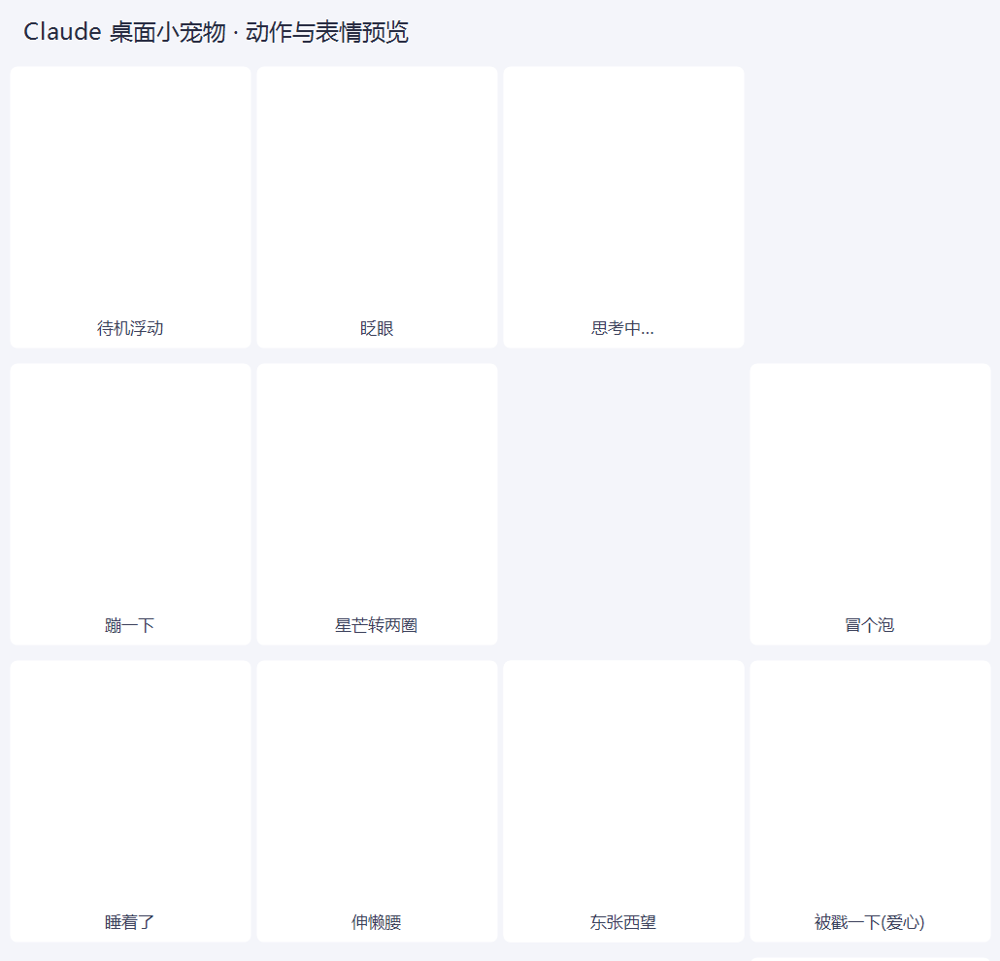

# Google 桌面小宠物 ☀

> 📦 **免安装下载**：[Releases](https://github.com/qi-cluadld/GooglePet/releases/latest) 下载 zip，解压后双击 `启动宠物.vbs` 即可（不用 clone、不用装任何运行库）。


一只趴在桌面上的 **Google Google 配色星芒**：会浮动、会眨眼、会转圈、会思考、会睡着，点它会有反应，还能和你桌面上另外几只 AI 宠物（Gemini ✨ / DeepSeek 🐋 / ChatGPT ✦）**互相打招呼、聊天、送爱心、吵架再和好**。

- **零依赖**：只用 Windows 自带的 WPF + PowerShell，不用装 Python / Node / 任何运行库
- **自己写自己画**：星芒、眼睛、腮红、表情、粒子全是 XAML 矢量画的，放大不糊
- **不抢焦点**：`WS_EX_NOACTIVATE | WS_EX_TOOLWINDOW`，点它不会打断你正在打的字
- 纯 PowerShell 实现，连开发辅助脚本都是 `.ps1`，一个 `.py` 都没有




## 快速开始

1. 双击 **`启动宠物.vbs`**（无控制台窗口），它会出现在屏幕右下角
   - 被安全软件拦了就改用 **`启动宠物.bat`**
2. 玩法：
   - **左键点一下** —— 戳它（会冒爱心、变开心脸、说一句）
   - **按住左键拖动** —— 换位置（拖动会中断它正在做的动作）
   - **右键** —— 菜单：打招呼 / 摸摸头 / 大小 / 退出
3. 想让它开机自动出现：把 `启动宠物.vbs` 的快捷方式丢进 `shell:startup`

## 命令行参数

```powershell
# 正常启动(指定大小: 0.7 / 1.0 / 1.4)

> 📦 **免安装下载**：[Releases](https://github.com/qi-cluadld/GooglePet/releases/latest) 下载 zip，解压后双击 `启动宠物.vbs` 即可（不用 clone、不用装任何运行库）。

powershell -NoProfile -ExecutionPolicy Bypass -File GooglePet.ps1 -Size 1.4

# 渲染 12 张动作预览图(开发用; 加 -PreviewAlpha 输出透明底, 用来做图标)

> 📦 **免安装下载**：[Releases](https://github.com/qi-cluadld/GooglePet/releases/latest) 下载 zip，解压后双击 `启动宠物.vbs` 即可（不用 clone、不用装任何运行库）。

powershell -NoProfile -ExecutionPolicy Bypass -File GooglePet.ps1 -Preview preview -PreviewAlpha

# 自检: 连续跑 N 个动作并检查有没有异常

> 📦 **免安装下载**：[Releases](https://github.com/qi-cluadld/GooglePet/releases/latest) 下载 zip，解压后双击 `启动宠物.vbs` 即可（不用 clone、不用装任何运行库）。

powershell -NoProfile -ExecutionPolicy Bypass -File GooglePet.ps1 -SelfTest 30
```
调试日志在 `%TEMP%\GooglePet.log`（设环境变量 `CLAUDEPET_VERBOSE=1` 会更详细）。

## 四只桌宠联动

同一台机器上只要开着两只以上就会自动联动，靠一块命名共享内存 `DesktopPets.Interop.v3` 交换位置与状态，**不需要任何后台服务**，谁在跑就跟谁联动。

| 联动行为 | 表现 |
| --- | --- |
| 👋 见面打招呼 | 靠近到约一个身位时，两只都会转头看过去、露出笑脸并冒爱心（对方睡着了还会把它叫醒） |
| 🗣 真·对话 | 会**一问一答**聊 2~3 个回合（开场 → 回应 → 追问 → 回应 → 道别），各自用自己的台词表 |
| 🧠 话题记忆 | 每次聊天挑一个话题，并且记得上次聊到哪儿：被打断的话题下次见面接着聊，同一个话题不会连着聊两次 |
| 💬 说话气泡 | 打招呼 / 聊天 / 一起玩 / 串门 / 被戳 / 发呆时都会冒一句台词 |
| 👀 对视 | 待在一起时眼睛持续朝对方方向偏，身体轻微侧倾 |
| 🎉 一起玩 | 挨着时每隔一会儿一起做动作，一边发起、另一边几秒内跟上 |
| ❤ 传爱心 | 偶尔送对方一颗小心心，对方会接住并回一句谢谢 |
| 🏃 追逐 | 中距离时偶尔追过去，被追的有一半概率会跑开，追上就一起玩 |
| 😤 吵架与和好 | 被同一个人反复追会被追烦 → 生气（不理人、躲开），对方看到会道歉并送颗小心心，气消了就**和好**、冒爱心继续玩 |
| 📏 排排站 | 挨在一起时会慢慢对齐高度，看起来像并排站着 |
| 🚶 串门 | 离得远时偶尔主动挪到另一只旁边待着，到了再打个招呼 |
| ↔️ 主动让位 | 挤成一坨时会自己让开一点，不会再叠在同一个角落 |

只开一只时联动完全不触发；想关掉就把本目录的 `social.ps1` 删掉（脚本检测不到会自动跳过，其余功能不受影响）。

> 实现说明：本目录的 `social.ps1`（共享内存通信 + 社交状态机 + 对话协议 + 情绪系统）是四只宠物**完全一样**的一份，各宠物在里面注册自己的「打招呼 / 一起玩 / 看向对方 / 移动到某处 / 送爱心 / 生气 / 和好」钩子。四个仓库都要同步这个文件。

## 台词表（外置，改文件就行）

`lines.json` 是它的全部台词，记事本就能改；`{me}` / `{you}` 会被替换成双方名字（小谷 / 小星星 / 小鲸鱼 / 小花）。

```json
{
  "name": "小谷",
  "lines": { "Greet": ["嗨！", "你好呀 ☀"], "Hello": ["嗨，{you}！"], "...": [] },
  "topics": [
    { "name": "晒太阳", "open": ["今天的太阳好舒服呀"], "reply": ["是呀，暖洋洋的"],
      "follow": ["{you}喜欢晴天还是雨天？"], "followReply": ["晴天！"], "bye": ["那下次一起晒~"] }
  ]
}
```
- 台词键：`Greet / Hello / HelloReply / Resume / Follow / FollowReply / Bye / Play / Visit / Pat / Idle / Gift / GiftReply / Chase / Angry / Sorry / Makeup`
- `topics` 是话题表（`open / reply / follow / followReply / bye`），想加新话题就往数组里加一条
- 改完保存、重启宠物即生效；文件删了或写坏了会自动退回脚本内置的默认台词

## U 盘热插拔自动备份

插上 U 盘就自动把工作区里的宠物同步过去：

1. 双击 **`启动U盘备份.vbs`**（无窗口，后台运行）
2. 之后每次插入 U 盘，都会自动备份到 `<U盘>\桌面小组件\`，并写下 `备份信息.txt` 记录时间与文件数
3. 想开机就监控：`启动U盘备份.vbs` → 发送到桌面快捷方式 → 放进 `shell:startup`

命令行：`powershell -NoProfile -ExecutionPolicy Bypass -File tools\usb_backup.ps1 [-Once] [-IntervalSec 5]`，日志在 `%TEMP%\USB备份.log`。

## 文件结构

```
GooglePet\
├─ GooglePet.ps1          主程序(由 build.ps1 组装生成, 单文件可独立运行)
├─ social.ps1             四只宠物共用的联动模块(共享内存 + 社交/对话/情绪)
├─ lines.json             台词表与话题表(可直接编辑)
├─ google_g_pet.ico/.png    图标
├─ 启动宠物.vbs / .bat     启动器(无窗口 / 带控制台)
├─ 预览外观.bat            给同事看外观用的预览启动器
├─ 启动U盘备份.vbs         U 盘热插拔自动备份监控
├─ build\                 开发用: 由「已验证框架 + 角色代码块」组装主程序
│   ├─ build.ps1          PowerShell 组装脚本(自动识别宠物目录)
│   └─ b_*.txt            角色代码块(头部/几何/XAML/动作/每帧/姿势/菜单…)
├─ tools\
│   ├─ shot.ps1           开发用: 截图 / 模拟点击拖动 / 枚举窗口
│   ├─ make_assets.ps1    开发用: 由预览图生成图标与合集图(纯 .NET)
│   └─ usb_backup.ps1     U 盘自动备份
└─ preview\               12 张动作预览 + 合集图
```

## 技术说明

- **窗口**：`AllowsTransparency` + `WindowStyle=None` 的分层窗口，240×240 DIP 画布，`Topmost`，Per-Monitor-V2 DPI 感知；用 `WS_EX_NOACTIVATE | WS_EX_TOOLWINDOW` 保证不抢焦点、不进 Alt+Tab
- **渲染**：30 fps `DispatcherTimer`（33ms），所有动画都在 `RenderTransform`（Scale → Rotate → Translate）和少量形状属性上，不重排布局
- **星芒**：12 边形柔和圆盘做核心，周围一圈Google 配色星芒；星芒层单独放在 `BitmapCache` 的画布**之外**（缓存画布不会刷新运行时新增的子元素，这是踩过的坑）
- **表情**：全部靠眼睛/嘴/腮红几个形状的属性插值，没有位图
- **联动**：命名共享内存 `DesktopPets.Interop.v3`，4 个槽位各 64 字节，写自己的、读别人的，用 `TickCount` 判断对方是否还在；对话是回合制协议（谁在说、说到哪一句、话题是哪个都写在槽里）
- **数值兜底**：所有变换值都做了 NaN/Infinity 检查（曾因为 `0/0` 让整只宠物不渲染）
- **边界保护**：宠物中心一旦离开工作区（联动移动、拖动、改分辨率）会立刻取消动作并把自己拉回屏幕内，不会"跑出桌面找不回来"

## 常见问题

- **双击没反应**：多半被安全软件拦了，改用 `启动宠物.bat` 能看到报错信息
- **想换台词/加话题**：改 `lines.json`（UTF-8），重启宠物
- **想调联动节奏**：`social.ps1` 里那几组冷却和概率（打招呼 9s / 一起玩 30s / 串门 70s / 让位 22s / 追人 55s / 生气门槛 3 次）都能直接改
- **只想自己玩**：删掉 `social.ps1` 即可（不影响其它功能）

## 开发

角色代码是按块维护的：`build\b_*.txt` 里是「造型 / 粒子 / 动作 / 每帧更新 / 预览姿势 / 菜单」这些角色专属部分，`build\build.ps1` 把它们拼进已验证的框架（取自 `..\GeminiPet\GeminiPet.ps1`）生成 `GooglePet.ps1`，换角色时不用重踩窗口/DPI/拖动/定时器那些坑。

改完外观后重新出图：

```powershell
# 1) 组装主程序

> 📦 **免安装下载**：[Releases](https://github.com/qi-cluadld/GooglePet/releases/latest) 下载 zip，解压后双击 `启动宠物.vbs` 即可（不用 clone、不用装任何运行库）。

powershell -NoProfile -ExecutionPolicy Bypass -File build\build.ps1
# 2) 重出预览图(透明底那份是给图标用的)

> 📦 **免安装下载**：[Releases](https://github.com/qi-cluadld/GooglePet/releases/latest) 下载 zip，解压后双击 `启动宠物.vbs` 即可（不用 clone、不用装任何运行库）。

powershell -NoProfile -ExecutionPolicy Bypass -File GooglePet.ps1 -Preview preview -PreviewAlpha
powershell -NoProfile -ExecutionPolicy Bypass -File GooglePet.ps1 -Preview "$env:TEMP\google_g_alpha" -PreviewAlpha
# 3) 重出图标与合集图

> 📦 **免安装下载**：[Releases](https://github.com/qi-cluadld/GooglePet/releases/latest) 下载 zip，解压后双击 `启动宠物.vbs` 即可（不用 clone、不用装任何运行库）。

powershell -NoProfile -ExecutionPolicy Bypass -File tools\make_assets.ps1 -AlphaDir "$env:TEMP\google_g_alpha"
```

## 同系列（十只）

| 宠物 | 品牌 | 仓库 |
| --- | --- | --- |
| 小星星 ✨ | Gemini | https://github.com/qi-cluadld/GeminiPet |
| 小鲸鱼 🐋 | DeepSeek | https://github.com/qi-cluadld/DeepseekPet |
| 小花 ✦ | ChatGPT | https://github.com/qi-cluadld/ChatGPTPet |
| 小谷 ☀ | Google | https://github.com/qi-cluadld/GooglePet |
| 小豆包 🥟 | 豆包 | https://github.com/qi-cluadld/DoubaoPet |
| 小千 🌀 | 通义千问 | https://github.com/qi-cluadld/QwenPet |
| 小飞 🚀 | Copilot | https://github.com/qi-cluadld/CopilotPet |
| 小象 ⭕ | 智谱 GLM | https://github.com/qi-cluadld/GLMPet |
| 小格 ⚔ | Grok | https://github.com/qi-cluadld/GrokPet |
| 小智 ✨ | Apple Intelligence | https://github.com/qi-cluadld/ApplePet |

十只可以**同时运行并互相联动**：打招呼、真对话（带话题记忆）、传爱心、追逐、吵架和好，以及**一对一打架**。
一键安装包（含十只，可自选）：https://github.com/qi-cluadld/DesktopPetsInstaller/releases
## License

MIT
